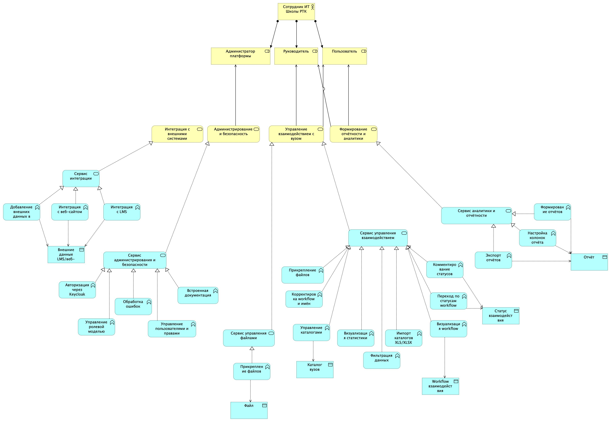
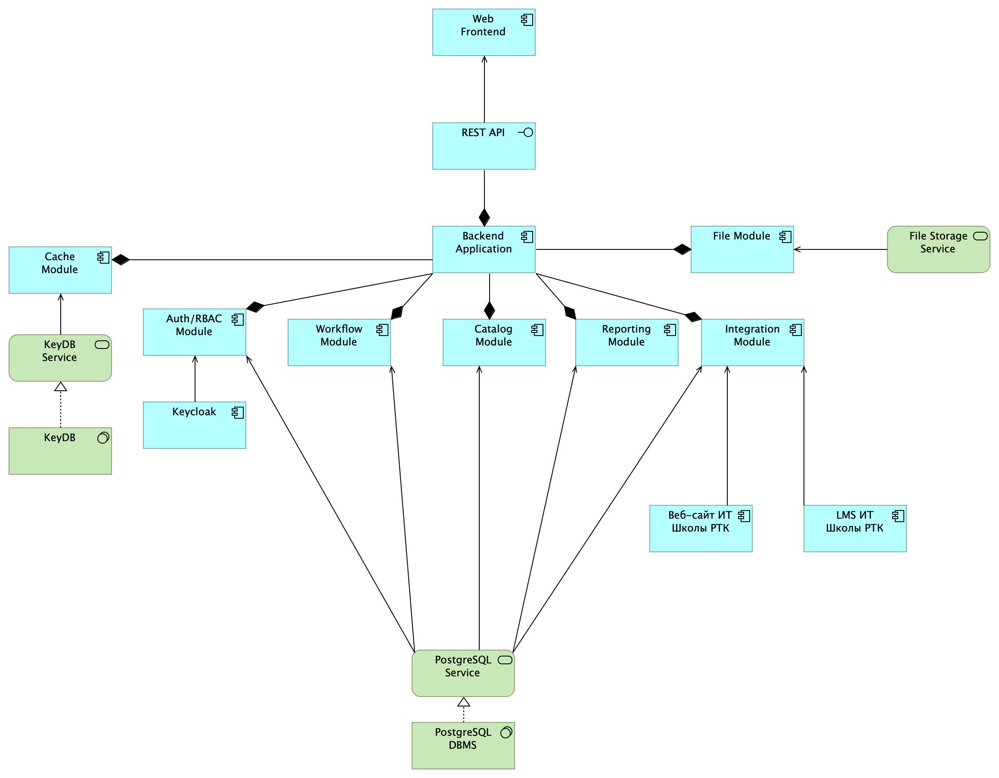
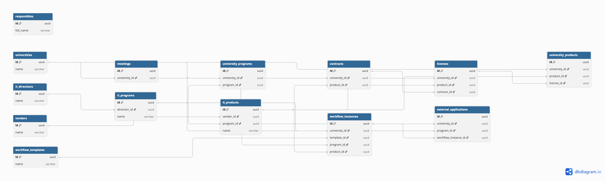

# CRM взаимодействия с учебными заведениями

Проект команды 26 для хакатона «Лидеры цифровой трансформации 2026».

CRM помогает команде ИТ Школы РТК вести работу с вузами в одном месте. В системе собраны карточки университетов, образовательные программы, продукты, договоры, лицензии, встречи и ответственные сотрудники. Работа по каждому направлению проходит через настраиваемый Workflow с задачами, комментариями, файлами и историей изменений.

|Параметр|Значение|
|:---|:---|
|Заказчик|ИТ Школа РТК, ООО «Ростелеком Информационные Технологии»|
|Номинация|Наука|
|Задача|[Кейс 16 на платформе ЛЦТ](https://i.moscow/hackaton/lct/179b401bb27649418735ecafbd037e1b)|

## Возможности

 1. Дашборд с ключевыми показателями и аналитикой по вузам.
 2. Каталог вузов с поиском, фильтрами и сортировкой.
 3. Паспорт вуза с программами, продуктами, договорами, лицензиями, встречами и ответственными.
 4. Данные по обучению преподавателей и агрегированная статистика LMS и сайта.
 5. Workflow по вузу и программе с переходами между этапами, возвратом на пройденный этап и контролем сроков.
 6. Ответственные на уровне всего Workflow и отдельного этапа.
 7. Задачи, комментарии, вложения и единая история работы.
 8. Управление шаблонами Workflow.
 9. Импорт каталогов из Excel с предварительной проверкой данных.
10. Отчёты в XLSX, PDF и JSON. Формирование выполняется отдельным фоновым обработчиком.
11. Журнал аудита с фильтрами и человекочитаемым описанием событий.
12. Управление пользователями и ролями через Keycloak.

Seed `seed_demo` создаёт один демонстрационный шаблон Workflow из пяти укрупнённых этапов и по одному экземпляру Workflow на каждый демо-вуз. Полный маршрут взаимодействия из четырнадцати этапов технического задания создаётся отдельно:

```bash
docker compose exec backend python scripts/create_workflow_template.py
```

## Роли

|Роль|Доступ|
|:---|:---|
|Пользователь|Просмотр вузов и Workflow, работа с этапами, задачами, комментариями, файлами и отчётами|
|Менеджер|Возможности пользователя, редактирование данных, импорт, аудит и назначение ответственных|
|Администратор|Полный доступ, управление пользователями, справочниками и шаблонами Workflow|

## Технологии

|Часть системы|Технологии|
|:---|:---|
|Frontend|Next.js 16, React 19, TypeScript, TanStack Query, React Hook Form, Zod, Recharts|
|Backend|Python 3.12, FastAPI, SQLAlchemy, Pydantic|
|Данные|PostgreSQL 16, миграции SQL|
|Авторизация|Keycloak 26, OpenID Connect, JWT, RBAC|
|Фоновые задачи|Отдельный процесс Python, очередь заданий в PostgreSQL, кэш с KeyDB API|
|Инфраструктура|Docker Compose, проверки состояния, постоянные тома|

## Архитектура

Подробное текстовое описание компонентов, потоков данных и внешних интеграций — в [docs/ARCHITECTURE.md](docs/ARCHITECTURE.md).

### Функциональная архитектура



### Компонентная архитектура



### Схема базы данных

Общая схема (полный размер — [full.png](docs/images/db-schema/full.png)):



Детализация по доменам:

|Домен|Схема|
|:---|:---|
|Справочники (направления, программы, продукты, вендоры)|[02-catalogs.png](docs/images/db-schema/02-catalogs.png)|
|Вузы, ответственные, встречи, документы|[03-universities.png](docs/images/db-schema/03-universities.png)|
|Workflow: шаблоны, этапы, экземпляры, задачи, комментарии, вложения|[04-workflow.png](docs/images/db-schema/04-workflow.png)|
|Сервисные таблицы: отчёты, аудит, outbox|[05-service.png](docs/images/db-schema/05-service.png)|

## Быстрый запуск (инструкция по запуску)

Понадобятся Docker, Docker Compose v2, 4 ГБ свободной оперативной памяти и около 10 ГБ на диске.

### 1. Подготовить окружение

Linux и macOS:

```bash
cp .env.example .env
```

Windows PowerShell:

```powershell
Copy-Item .env.example .env
```

### 2. Запустить сервисы

```bash
docker compose up -d --build
```

Первый запуск обычно занимает до двух минут. Keycloak создаёт свою базу и импортирует realm `rtk`. Backend применяет SQL миграции автоматически.

Проверить состояние контейнеров:

```bash
docker compose ps
```

### 3. Загрузить демонстрационные данные

```bash
docker compose exec -e SEED_DEMO_DATA=true backend python -m app.scripts.seed_demo
```

Команду можно запускать повторно. Она не создаёт дубликаты и не удаляет существующие данные.

### 4. Открыть приложение

|Сервис|Адрес|
|:---|:---|
|CRM|<http://localhost:3000>|
|Backend API|<http://localhost:8000>|
|Swagger UI|<http://localhost:8000/docs>|
|ReDoc|<http://localhost:8000/redoc>|
|Keycloak|<http://localhost:8081>|
|Swagger (стенд)|https://158.160.202.104/docs|
|ReDoc (стенд)|https://158.160.202.104/redoc|
|OpenAPI JSON (стенд)|https://158.160.202.104/openapi.json|

Swagger: https://158.160.202.104/docs
ReDoc: https://158.160.202.104/redoc
OpenAPI JSON: https://158.160.202.104/openapi.json

Подробная инструкция по запуску, обновлению, резервному копированию и диагностике — в [docs/INSTALL.md](docs/INSTALL.md).

### 5. API-документация (Swagger)

После запуска стенда интерактивная документация backend доступна без дополнительной настройки:

|Ресурс|Адрес|
|:---|:---|
|Swagger UI|http://localhost:8000/docs|
|ReDoc|http://localhost:8000/redoc|
|OpenAPI-спека (JSON)|http://localhost:8000/openapi.json|

Как пользоваться:
1. Открой Swagger UI — операции сгруппированы по тегам (Universities, Workflow, Reports…), у каждой есть русское описание и требуемые права.
2. Для защищённых ручек нажми **Authorize** → **KeycloakLogin**: откроется штатная страница логина Keycloak (Authorization Code + PKCE, пароль вводится только там и никуда больше не передаётся) — войди (например `admin` / `admin123`), токен подставится сам. Других кнопок входа в Swagger нет — это единственный способ. Без токена API вернёт 401.
3. Для локальной проверки подходят демонстрационные пользователи из раздела ниже.
4. `openapi.json` можно импортировать в Postman/Insomnia или использовать для генерации API-клиентов.

Дока собирается из кода backend автоматически. После правок описаний в `backend/app/modules/**/router.py` пересобери образ: `docker compose up -d --build backend`.

## Демонстрационные пользователи

|Логин|Пароль|Роль|
|:---|:---|:---|
|`admin`|`admin123`|Администратор|
|`manager`|`manager123`|Менеджер|
|`user`|`user123`|Пользователь|

Эти учётные записи и пароли предназначены только для локального стенда.

## Полезные команды

Посмотреть логи:

```bash
docker compose logs -f backend frontend worker keycloak
```

Проверить миграции:

```bash
docker compose exec backend python scripts/migrate.py status
docker compose exec backend python scripts/migrate.py verify
```

Пересобрать приложение после изменений:

```bash
docker compose up -d --build
```

Остановить стенд без удаления данных:

```bash
docker compose down
```

Полностью удалить локальные данные и начать заново:

```bash
docker compose down -v
```

Последняя команда удаляет базы, загруженные файлы и сформированные отчёты. Используйте её только для локальной разработки.

## Настройка

Основные параметры находятся в `.env`.

|Переменная|Назначение|
|:---|:---|
|`POSTGRES_PASSWORD`|Пароль базы приложения|
|`KEYCLOAK_DB_PASSWORD`|Пароль базы Keycloak|
|`KEYCLOAK_ADMIN_PASSWORD`|Пароль администратора Keycloak|
|`KEYCLOAK_EXTERNAL_URL`|Адрес Keycloak, который открывает браузер|
|`FRONTEND_ORIGIN`|Разрешённый адрес frontend|
|`NEXT_PUBLIC_DATA_SOURCE`|Источник данных frontend, обычно `real`|
|`EXTERNAL_ADAPTER_MODE`|Режим интеграций с LMS и сайтом|
|`STORAGE_BACKEND`|Хранилище файлов, `local`, `s3` или `minio`|

Значения `change-me` подходят только для локального запуска. Перед публикацией стенда задайте отдельные сложные пароли и корректные публичные адреса.

## Структура репозитория

|Каталог|Содержимое|
|:---|:---|
|`backend`|FastAPI, серверная логика, модели, миграции, фоновые задачи и тесты|
|`frontend`|Next.js приложение и сценарии Playwright|
|`keycloak`|Realm, пользователи, роли и тема страницы входа|
|`docker`|Инициализация PostgreSQL|
|`docs`|Архитектура, инструкции, безопасность и описание интеграций|
|`scripts`|Подготовка демонстрационного стенда, проверка запуска и диагностика Docker|

## Документация

|Документ|Содержание|
|:---|:---|
|[Установка](docs/INSTALL.md)|Запуск, обновление, резервная копия и диагностика|
|[Руководство пользователя](docs/USER_GUIDE.md)|Основные разделы CRM и рабочие сценарии|
|[Архитектура](docs/ARCHITECTURE.md)|Компоненты системы и связи между ними|
|[Методы обработки данных](docs/DATA_PROCESSING.md)|Миграции, API, импорт, отчёты, интеграции, аудит|
|[Условия и ограничения](docs/CONSTRAINTS.md)|Условия работы стенда, лимиты, соответствие|
|[Интеграция API](docs/API_INTEGRATION.md)|Контракты frontend и backend|
|[Демонстрационные данные](docs/DEMO_SEED.md)|Состав seed и правила повторного запуска|
|[Безопасность](docs/SECURITY_ALIGNMENT.md)|Реализованные меры и ограничения прототипа|
