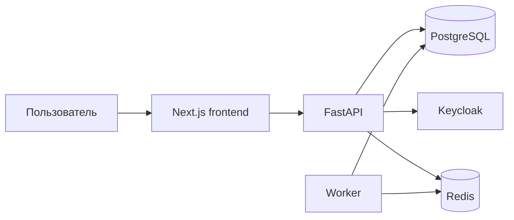

# Архитектура CRM

## Компоненты

1. **Frontend** — Next.js App Router, React и TypeScript. Страницы получают данные через репозитории и TanStack Query. В обычном режиме репозитории обращаются к API; mock-режим включается только явной настройкой среды разработки.
2. **API** — FastAPI (`/api/v1`) для вузов, каталогов, Workflow, импорта, аналитики, отчётов, пользователей и аудита.
3. **Данные** — PostgreSQL. SQL-миграции в `backend/migrations/` определяют схему CRM; Keycloak использует отдельную базу.
4. **Авторизация** — Keycloak выдаёт токены; backend проверяет JWT, роли, разрешения и область доступа к вузам.
5. **Фоновые задачи** — отдельный worker обрабатывает импорт и формирование отчётов. Redis используется для очередей и кэша.
6. **Развёртывание** — Docker Compose запускает frontend, backend, worker, Keycloak, PostgreSQL и Redis.

## Внешние данные

Импорт справочников и интеграционные адаптеры имеют отдельные API-контракты. Доступность внешних LMS и сайта зависит от настроенного источника; ошибка реального API не подменяется mock-данными.

## Модель ArchiMate

Исходная модель, PNG-схема и инструкция по генерации находятся в [`docs/archimate/`](archimate/README.md).
