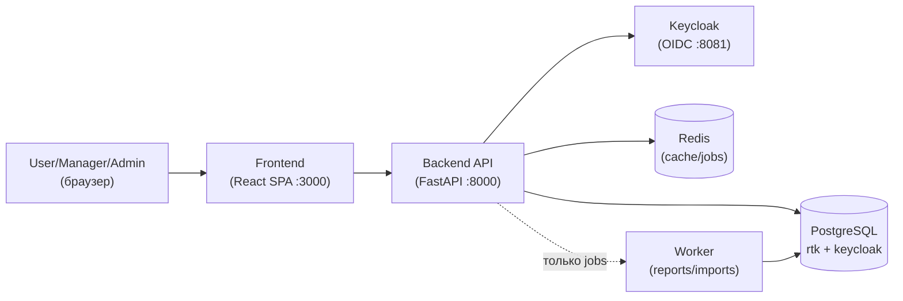

# Архитектура (P5-15-01 + P5-16-01)

## Слои
1. **Presentation** — React SPA (nginx, same-origin `/api/` proxy, runtime `/config.json`).
2. **API** — FastAPI (`/api/v1`): auth, catalog, passports, workflow, health-score,
   analytics, reports (только создание job + статус + скачивание), import.
3. **Domain** — сервисы: passport, workflow engine, health calculator (T/D/S/E/L),
   policy engine (RBAC + university scope), audit logger.
4. **Data** — PostgreSQL: две БД на одном сервере — `rtk` (миграции `backend/migrations/`,
   единственный источник истины схемы) и `keycloak` (таблицы Keycloak/Liquibase).
5. **Identity** — Keycloak 26 (realm `rtk`, клиент `rtk-frontend`, `aud=rtk-api`).
6. **Reporting/Background** — отдельный `worker`-контейнер: report jobs и
   `xlsx_import` через атомарный claim (`FOR UPDATE SKIP LOCKED`), до 3 попыток.
   BackgroundTasks в API запрещены.
7. **Infrastructure** — Docker Compose: postgres, redis, keycloak, backend, worker,
   frontend; volumes `pgdata/redisdata/import-staging/workflow-storage/reports-storage`;
   сеть `rtk-net`; healthchecks у всех сервисов.

## Контекст (Mermaid)

## Кэширование
- Backend: `app/services/cache.py` (каталоги 5 мин, health-score 5 мин,
  аналитика 1 мин) поверх `app/infrastructure/redis.py` (in-memory fallback);
  инвалидация писателями после CREATE/UPDATE/DELETE.
- Frontend: `src/api/queryClient.ts` (stale 30s, GC 5min, retry 2, без refetch
  при фокусе) + `src/stores/filters.ts` (фильтры в sessionStorage).
  Целевой стек — TanStack Query + zustand/persist с теми же ключами.

## Внешние интеграции
Живых LMS/сайта нет: стаб `modules/integrations` (deferred, не смонтирован),
демо работает на seed без внешней сети (см. `scripts/demo-setup.sh`).

## ArchiMate
8 слоёв P5-16-01 отражены выше; `.archimate`-модель — в
`docs/archimate/architecture.archimate` (Dev-3, открывается в Archi),
PNG-схема — `docs/archimate/architecture.png`; генератор и инструкция —
`docs/archimate/README.md`.
