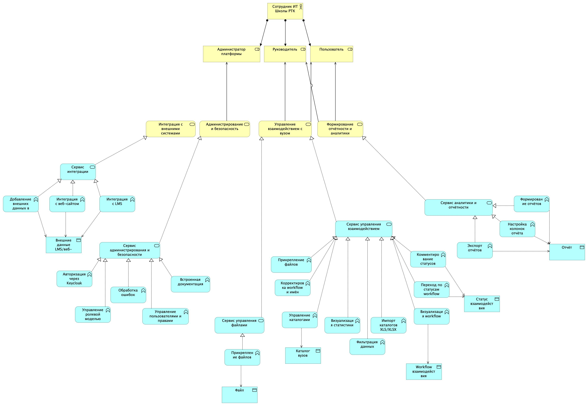
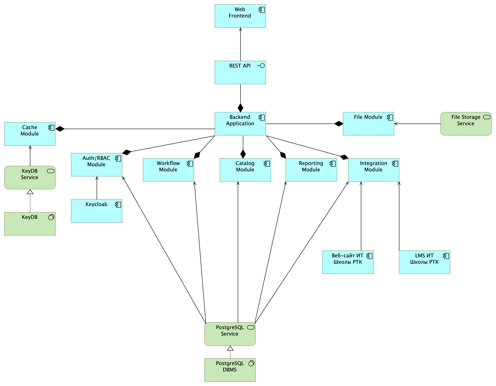

# Архитектура CRM

Система — классический трёхзвенный веб-продукт: Next.js-фронтенд, FastAPI-бэкенд,
PostgreSQL как единственное persistent-хранилище доменных данных, Keycloak как
внешний IdP, KeyDB как кэш, отдельный worker для долгих операций. Всё поднимается
одним `docker compose up -d --build`.

## Функциональная архитектура

Четыре функциональных блока:

1. **Управление взаимодействием с вузом** — каталог вузов, паспорт вуза,
   Workflow по вузу/программе (этапы, переходы, возврат, сроки), задачи,
   комментарии, файлы, импорт каталогов из XLSX, визуализация статистики.
2. **Формирование отчётности и аналитики** — дашборд, сервис аналитики,
   настройка колонок, экспорт отчётов в XLSX/PDF/JSON.
3. **Администрирование и безопасность** — авторизация через Keycloak, ролевая
   модель (пользователь / менеджер / администратор), управление пользователями
   и правами, журнал аудита, встроенная документация.
4. **Интеграция с внешними системами** — адаптеры LMS и сайта ИТ Школы РТК
   (режим задаётся `EXTERNAL_ADAPTER_MODE`, по умолчанию `disabled`: стенд
   работает без внешних систем, ошибка реального API не подменяется моками).

Роли: администратор платформы, руководитель (менеджер), пользователь. Сотрудник
ИТ Школы РТК работает через веб-интерфейс, прямых доступов к БД у ролей нет.

## Компонентная архитектура

- **Web Frontend** — Next.js 16, React 19, TypeScript, TanStack Query,
  React Hook Form + Zod, Recharts. Ходит в backend только через REST API
  (`/api/v1`, в compose — через same-origin прокси `/api/v1/`).
- **REST API / Backend Application** — FastAPI (Python 3.12). Модули:
  `Auth/RBAC`, `Catalog`, `Workflow`, `Reporting`, `Integration`, `File`,
  `Cache`. Доменные модули: universities, programs, catalogs, workflow
  (templates / instances / transitions / tasks / comments / attachments),
  imports, analytics/reporting, audit, meetings, documents.
- **PostgreSQL 16** — единственное хранилище доменных данных. Схема задаётся
  только SQL-миграциями в `backend/migrations/` (`scripts/migrate.py up/verify`,
  при старте backend миграции применяются автоматически). Keycloak хранит свои
  таблицы в отдельной базе `keycloak` на том же сервере.
- **Keycloak 26** — внешний IdP (realm `rtk`, OpenID Connect). Backend проверяет
  JWT (issuer/JWKS/audience), роли и область доступа к вузам. Демо-вход
  `admin/manager/user` — только для локального стенда.
- **KeyDB** (Redis-совместимый кэш) — кэш и лёгкие очереди. Очередь долгих
  заданий (отчёты, импорт) — в PostgreSQL, исполняет её отдельный процесс.
- **Worker** — отдельный Python-процесс (`app.modules.analytics.report_worker`):
  забирает задания из очереди в Postgres (атомарный claim через `SKIP LOCKED`,
  до 3 попыток), кладёт результат в `reports-storage`. В API нет BackgroundTasks.
- **File Storage Service** — файловые вложения Workflow и импортов
  (`STORAGE_BACKEND=local|s3|minio`, по умолчанию local-тома
  `workflow-storage`, `import-staging`).
- **Внешние системы** — веб-сайт и LMS ИТ Школы РТК подключаются только через
  модуль интеграции при настроенных адресах и контрактах; в поставке их нет.

Типовой поток: браузер → frontend (3000) → `REST API` (8000) → PostgreSQL;
авторизация — через Keycloak (8081); тяжёлые отчёты/импорт — постановка задания
в Postgres → worker → готовый файл.

## Развёртывание

`docker-compose.yml`: `postgres`, `keydb`, `keycloak`, `backend`, `worker`,
`frontend`. Проверки состояния (healthcheck) на каждом сервисе, постоянные тома
`pgdata`, `keydbdata`, `import-staging`, `workflow-storage`, `reports-storage`.

| Сервис | Порт наружу |
|:---|:---|
| CRM (frontend) | 3000 |
| Backend API / Swagger / ReDoc | 8000 (`/docs`, `/redoc`) |
| Keycloak | 8081 |

Конфигурация — через `.env` (см. README и `docs/INSTALL.md`).

## Исходная модель

Исходник схем — [`archimate/lks.archimate`](archimate/lks.archimate) (открывается в Archi).

## Схема базы данных

Полная схема — [`images/db-schema/full.png`](images/db-schema/full.png), обзор —
[`images/db-schema/01-overview.png`](images/db-schema/01-overview.png):

- справочники — [`02-catalogs.png`](images/db-schema/02-catalogs.png);
- вузы и связи — [`03-universities.png`](images/db-schema/03-universities.png);
- Workflow — [`04-workflow.png`](images/db-schema/04-workflow.png);
- сервисные таблицы (отчёты, аудит, outbox) — [`05-service.png`](images/db-schema/05-service.png).
