# Swagger: вход и проверка прав

Проверено вручную в браузере 18.10.2026 на локальном стенде `http://localhost:8000/docs`.

Скриншоты сняты с реального интерфейса. Использованы демонстрационные учётные записи. JWT и пароли на снимках не раскрываются.

Быстрый маршрут: **Authorize → KeycloakLogin → вход в Keycloak → Close → Auth → GET /api/v1/auth/me → Try it out → Execute → 200**.

На другом стенде используйте его публичные адреса и свои учётные данные. Демонстрационные пароли ниже относятся к локальному окружению.

## 1. Откройте Swagger

Откройте http://localhost:8000/docs. В правой части страницы нажмите Authorize.

Для проверки используем только GET-запросы. Начните со входа через Keycloak; готовый JWT можно вставить отдельно.

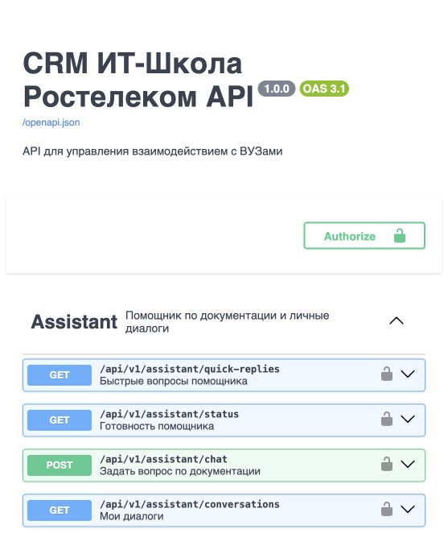

*Исходная страница. Authorize открывает настройки входа.*

## 2. Выберите один способ входа

KeycloakLogin открывает форму входа Keycloak и получает токен автоматически.

HTTPBearer принимает уже выданный access_token. Достаточно одного способа; при переключении сначала нажмите Logout у предыдущего.

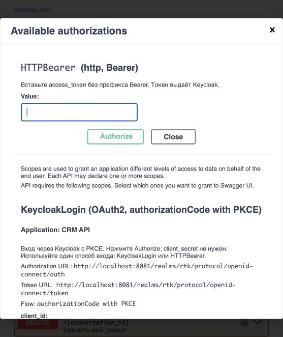

*Два варианта в одном окне: HTTPBearer сверху, KeycloakLogin ниже.*

## 3. Проверьте настройки KeycloakLogin

Прокрутите окно до KeycloakLogin. client_id: rtk-frontend; client_secret оставьте пустым; scope openid должен быть выбран.

Нажмите Authorize именно в секции KeycloakLogin. Откроется отдельное окно Keycloak.

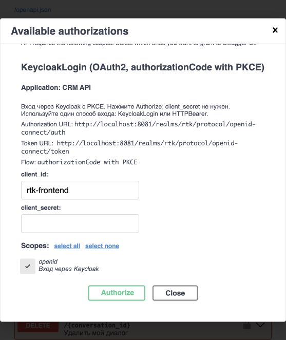

*Настройки локального стенда. Секрет клиента вводить не нужно.*

## 4. Войдите в Keycloak

Введите логин и пароль своей учётной записи, затем нажмите «Вход».

Для этого локального демо: admin / admin123. Пароль вводится в окне Keycloak на localhost:8081. Дождитесь закрытия окна и возврата в Swagger.

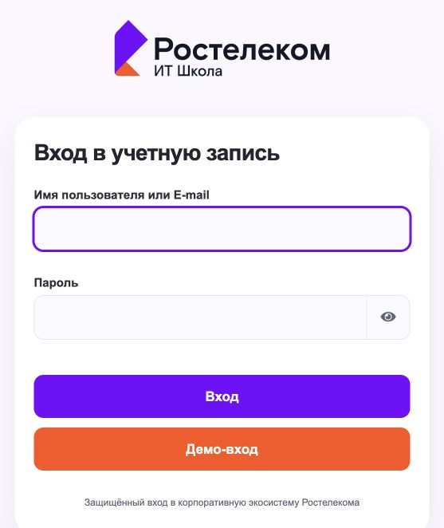

*Форма Keycloak. На снимке поля оставлены пустыми.*

## 5. Убедитесь, что вход выполнен

В секции KeycloakLogin должна появиться надпись Authorized, а кнопка Authorize сменится на Logout.

Нажмите Close. Замки у защищённых операций станут закрытыми. Эта индикация означает, что токен применён; фактический доступ проверим запросом.

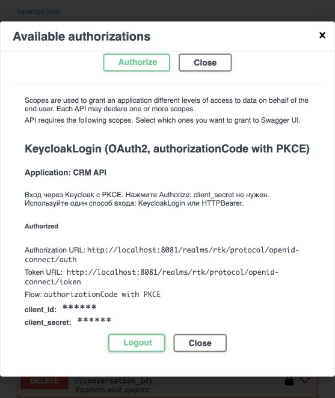

*Успешный OAuth-вход: Authorized и кнопка Logout.*

## 6. Выполните GET /api/v1/auth/me

Найдите раздел Auth и раскройте GET /api/v1/auth/me. Нажмите Try it out.

Параметров у метода нет. Нажмите появившуюся кнопку Execute. Ниже откроется результат в блоке Server response.

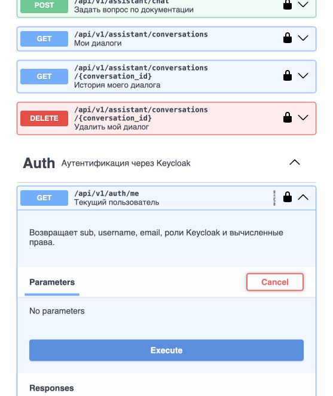

*После Try it out: доступна кнопка Execute; Cancel отменяет режим ввода.*

## 7. Проверьте ответ 200 и свою роль

Проверьте фактический код в Server response, а не таблицу документированных Responses ниже. Ожидается 200.

В Response body проверьте username, roles и permissions. В нашем проходе: username = admin, roles = ["admin"], permissions = ["*"].

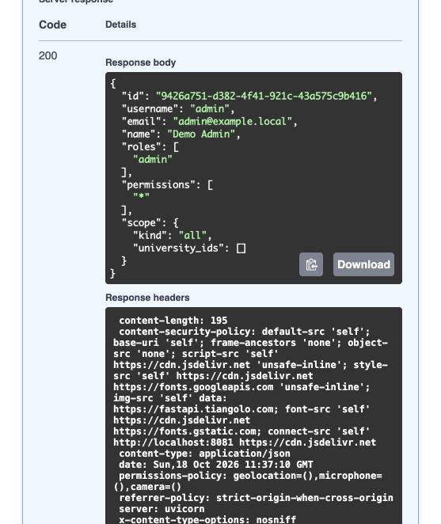

*Реальный ответ /auth/me после входа администратором. JWT находится за пределами кадра.*

## 8. Альтернатива: вставьте готовый JWT

Если ранее применяли KeycloakLogin, откройте Authorize и нажмите Logout в его секции. Затем перейдите к HTTPBearer.

В Value вставьте только access_token: без слова Bearer, кавычек и переноса строки. Нажмите Authorize в секции HTTPBearer.

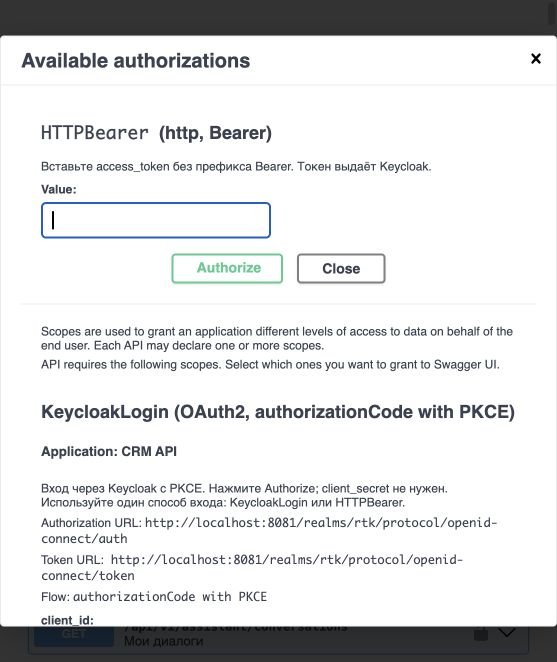

*Поле HTTPBearer до вставки токена. Сам токен в гайде не публикуется.*

## 9. Проверьте применение Bearer-токена

В секции HTTPBearer появится Authorized и маскированное Value: ******. Нажмите Close.

Swagger сам добавляет заголовок Authorization: Bearer <access_token>. При смене пользователя используйте токен нужной учётной записи.

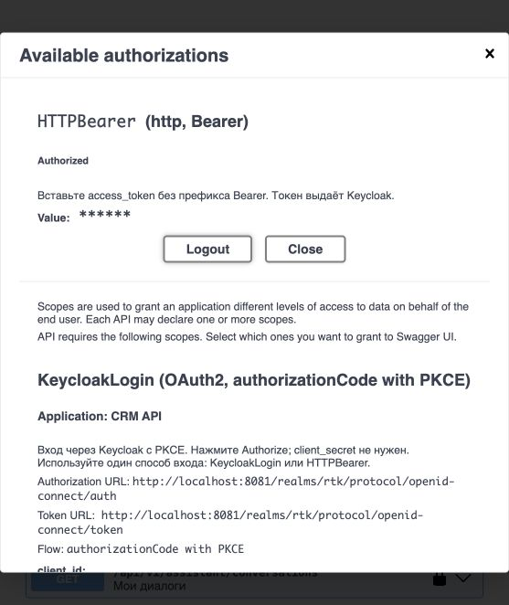

*Bearer-авторизация включена; значение токена скрыто интерфейсом.*

## 10. Повторите /auth/me с Bearer-токеном

Выполните тот же GET /api/v1/auth/me через Try it out и Execute. Ожидается 200 и данные владельца токена.

В проверке использован тот же access_token администратора, который был получен при OAuth-входе. Ответ снова содержит роль admin.

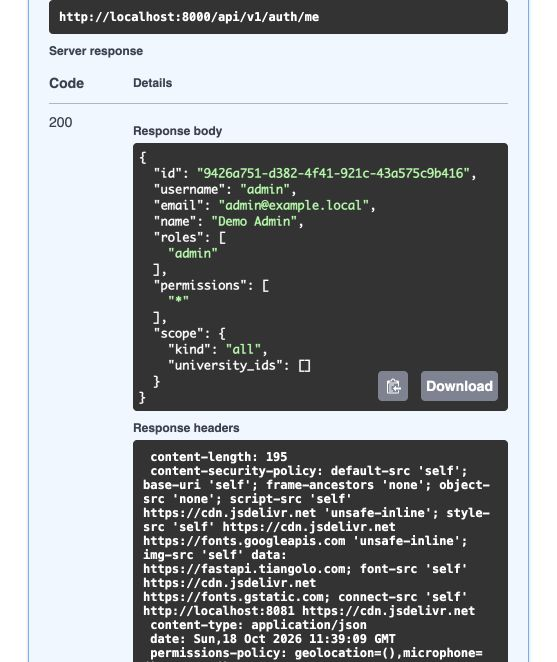

*Успешный запрос через ручную Bearer-авторизацию.*

## 11. Выйдите и проверьте ответ 401

Откройте Authorize, нажмите Logout у активного способа и затем Close. Выполните /auth/me заново.

Ожидается 401 и error.code = AUTH_REQUIRED. Перезагрузка страницы также сбрасывает авторизацию Swagger. Logout удаляет токен из Swagger; сессия Keycloak может остаться активной.

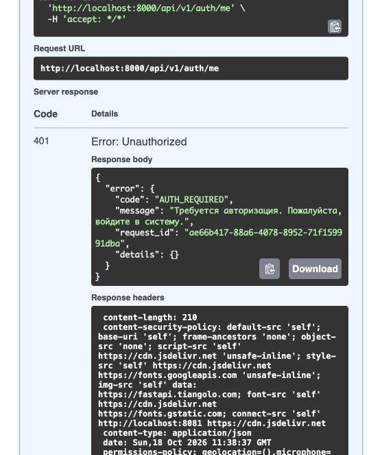

*После Logout защищённый запрос отклонён: 401 AUTH_REQUIRED.*

## 12. Проверьте роль manager

Для проверки прав войдите через Keycloak как manager / manager123 на локальном демо. Затем выполните /auth/me.

Ожидаются 200 и roles = ["manager"]. Если Keycloak показывает прежний логин и просит только пароль, нажмите значок «Перезапустить вход» рядом с логином и выберите другую учётную запись.

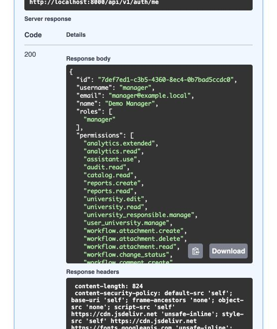

*Менеджер успешно аутентифицирован; API возвращает его роль и разрешения.*

## 13. Отличайте вход от права на операцию

Не меняя пользователя manager, раскройте GET /api/v1/auth/test/admin и нажмите Try it out, затем Execute.

Ожидаются 403 и error.code = FORBIDDEN: пользователь вошёл, но роли admin у него нет. Повторный вход тем же пользователем не добавляет ему прав.

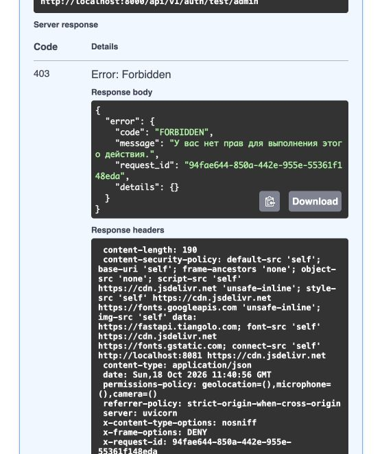

*Реальная проверка ограничения: manager получает 403 на admin-методе.*

## Результаты ручного прохода

| Сценарий | Фактический результат |
|---|---|
| KeycloakLogin, admin → /auth/me | 200; roles содержит admin |
| HTTPBearer, JWT admin → /auth/me | 200; токен применён к запросу |
| Logout → /auth/me | 401 AUTH_REQUIRED |
| KeycloakLogin, manager → /auth/me | 200; roles содержит manager |
| manager → /auth/test/admin | 403 FORBIDDEN |
| Перезагрузка страницы | Замки открыты; авторизация Swagger сброшена |

## Если вход не получается

| Симптом | Что проверить |
|---|---|
| Окно Keycloak не открылось | Проверьте блокировку всплывающих окон для адреса Swagger. |
| Incorrect redirect_uri / invalid_redirect_uri | В Keycloak должен быть зарегистрирован точный публичный адрес Swagger /docs/oauth2-redirect.html, включая порт и префикс прокси. |
| Failed to fetch при входе | Проверьте доступность Keycloak из браузера и Web Origins клиента. В локальном стенде origin Swagger: http://localhost:8000. |
| 401 TOKEN_EXPIRED / TOKEN_INVALID | Войдите заново либо вставьте действующий access_token. Для HTTPBearer не добавляйте префикс Bearer. |
| 403 FORBIDDEN | Проверьте роли, разрешения и доступную область данных пользователя. Валидный токен сам по себе не даёт всех прав. |
| Закрыли окно до возврата в Swagger | Повторите вход из Authorize → KeycloakLogin и дождитесь Authorized. |

В узком окне секция KeycloakLogin и её кнопка Authorize находятся ниже: прокрутите само окно авторизации.

Код 401 означает проблему с аутентификацией; код 403 означает недостаток прав. Надпись Authorized в окне Swagger не заменяет проверку фактического ответа API.

После проверки Swagger оставлен без активной авторизации. В ходе прохода выполнялись только GET-запросы API.

Связанные инструкции: [установка и настройки Keycloak](INSTALL.md#swagger-и-вход-через-keycloak).
